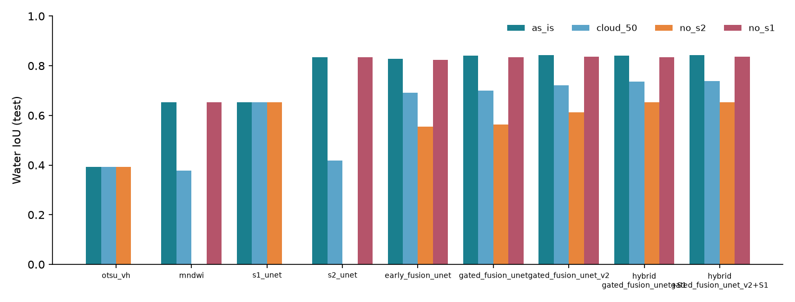

# AegisEO - Agentic Multi-Sensor Disaster Change Detection and Response Prioritisation

AegisEO turns **Sentinel-1 radar** and **Sentinel-2 optical** imagery, together with open
context data, into **evidence-backed response priorities** - and knows when to ask a person.
An AI agent finds and quality-checks the satellite data, maps what changed with a calibrated
multi-sensor deep-learning model, estimates who and what may be exposed, ranks response
cells with plain-language explanations, drafts grounded alerts and routes anything uncertain
or high-impact to human reviewers. Nothing is published without human approval.

Inspired by the multi-sensor Earth-observation problem space of companies such as GalaxEye
Space; built entirely on public data (no private data assumed).



## What it does

| Capability | How |
|---|---|
| **Multi-sensor change detection** | Dual-branch gated-fusion U-Net (Sentinel-1 + Sentinel-2) trained on Sen1Floods11, post-classification comparison against the pre-event image, JRC permanent water removed, SAR log-ratio and MNDWI corroboration, terrain plausibility (slope, height above drainage). Wildfire: dNBR with USGS severity classes; landslides: multi-indicator candidates. |
| **Calibrated confidence and uncertainty** | Temperature scaling (validation split), Monte-Carlo dropout uncertainty, per-pixel sensor-reliance map, input-distribution-shift check. |
| **Exposure / impact** | Population (Meta/CIESIN HRSL, WorldPop cross-check), hospitals, schools, emergency services, utilities, settlements and roads (OpenStreetMap), land cover (ESA WorldCover). Always "potentially exposed", never claimed impact. |
| **Explainable prioritisation** | `score = 100 x Hazard^a x Exposure^(1-a)` on response cells, factor contributions, life-safety floor rule, separate confidence, Monte-Carlo weight-sensitivity analysis, missing-data flags, suggested considerations. |
| **Closed-loop agent** | Observe -> Perceive -> Semantic state -> Memory/RAG -> Reason/Plan -> Tool actions -> Guardrails/HITL -> Outcome -> Feedback, with an explicit goal, plan, typed facts, recorded decisions (rules P0-P9), 20 tools under a side-effect policy, 18 guardrails and a full trace. |
| **Human in the loop** | Review queue (confirm / false positive / acknowledge / re-run), alert approval with publication guardrail, priority overrides with reasons, audit log, decisions remembered for later analyses. |
| **Reporting** | Interactive map (overlays, before/after swipe, popups), PDF report, CSV priorities, GeoJSON, GeoTIFF products. |
| **Monitoring** | Live data-source health, Prometheus `/metrics`, structured logs, dashboard agent metrics (tool success, escalation, override, latency). |

## Results (Sen1Floods11, hand-labelled)

Water IoU of the deployed configuration (*gated-fusion v2 + Sentinel-1 specialist*, selected
on the **validation** split) versus baselines. "No optical" simulates persistent cloud.
Full tables: [docs/evaluation_results.md](docs/evaluation_results.md).

| Method | Test, as provided | Test, 50 % cloud | Test, no optical | Bolivia (unseen), as provided | Bolivia, no optical |
|---|---|---|---|---|---|
| Otsu threshold, SAR VV (classical) | 0.431 | 0.431 | 0.431 | 0.575 | 0.575 |
| MNDWI > 0, optical (classical) | 0.653 | 0.378 | n/a | 0.556 | n/a |
| Sentinel-2 U-Net | 0.833 | 0.419 | n/a | 0.818 | n/a |
| Early-fusion U-Net | 0.828 | 0.691 | 0.555 | 0.818 | 0.597 |
| Gated fusion v1 | 0.841 | 0.699 | 0.562 | 0.829 | 0.280 |
| **Deployed: gated fusion v2 + S1 specialist** | **0.844** | **0.739** | **0.653** | **0.828** | **0.520** |

Test split, deployed model: F1 0.915, precision 0.932, recall 0.899; expected calibration
error 0.014 -> 0.005 after temperature scaling (T = 1.66); MC-dropout uncertainty detects
errors with AUROC 0.885 (keeping the 90 % most confident pixels raises IoU from 0.82 to 0.94).

Agent benchmark (12 closed-loop scenarios on simulated scenes with ground truth + 8 safety
probes): **12/12 cases and 8/8 probes passed**; escalation recall and precision 1.0; every
drafted alert passed the grounding check; mean change-detection IoU 0.78
([docs/benchmark_results.md](docs/benchmark_results.md)).

Real-data acceptance (five historical events run end to end with live archive data): Sindh
2022 flood 78.2 km2 mapped, Emilia-Romagna 2023 flood 31.6 km2, Palisades 2025 burn scar
53.9 km2, Wayanad 2024 landslide candidates 4.7 km2 (routed to review), Derna 2023 flash flood
0.03 km2 (water gone before the first pass - a stated limitation). See
[docs/acceptance.md](docs/acceptance.md), including a full tool-call trace.

Honest caveats are in [docs/failure_analysis.md](docs/failure_analysis.md) - e.g. on the unseen
Bolivia event, classical per-scene Otsu thresholding on VH (0.645) beats every learned SAR
model when optical data are missing.

## Architecture

```
React + MapLibre SPA  ──►  FastAPI (aegis)  ──►  Job pool ──► Agent orchestrator ──► Tool executor
                                │                                    │                    │
                         SQLite / PostgreSQL+PostGIS        guardrails · plan · state      ├─ Planetary Computer (S1 RTC, S2 L2A, DEM, JRC, WorldCover)
                                │                                    │                    ├─ OpenStreetMap, HRSL, WorldPop
                         artefacts (overlays, reports)      fusion model · analysis        └─ GDACS, USGS, FIRMS, Open-Meteo, (Claude)
```

Details and diagrams: [docs/architecture.md](docs/architecture.md) ·
agent design, state machine, rules and guardrails: [docs/agent_design.md](docs/agent_design.md).

## Technology

Python 3.12, FastAPI, SQLAlchemy 2, PyTorch, rasterio/GDAL, shapely, pyproj, NumPy/SciPy,
scikit-learn (TF-IDF RAG), ReportLab, Prometheus client · React 19, TypeScript, Vite,
TanStack Query, MapLibre GL 5 · PostgreSQL 16 + PostGIS, Docker Compose, nginx · pytest,
Vitest, Testing Library, Playwright.

## Quick start (local)

Requirements: Python 3.11-3.13, Node 20+, internet access for live data (an offline demo
works without it).

```bash
# backend
cd backend
python -m venv .venv
.venv/Scripts/activate            # Windows;  source .venv/bin/activate on macOS/Linux
pip install torch --index-url https://download.pytorch.org/whl/cpu   # or /whl/cu126 for NVIDIA GPUs
pip install -r requirements-dev.txt
pip install -e . --no-deps
uvicorn aegis.main:app --port 8000

# frontend (second terminal)
cd frontend
npm install
npm run dev                       # http://localhost:5173 (proxies /api to :8000)
```

Open http://localhost:5173, then **Try the offline demo** (simulated scene, ~10 s) or pick a
real case study (Sindh 2022 floods, Palisades Fire 2025, ...; 2-6 min with live data).

The trained checkpoints are included in `models/`. To reproduce them:

```bash
cd backend
python scripts/download_sen1floods11.py --out ../data/datasets/sen1floods11         # ~1.8 GB
python -m aegis.ml.prepare --raw ../data/datasets/sen1floods11 --out ../data/datasets/sen1floods11_prepared
python scripts/train_all.py --data ../data/datasets/sen1floods11_prepared --models ../models
python -m aegis.ml.train --variant gated_fusion_unet_v2 --data ../data/datasets/sen1floods11_prepared --out ../models
python -m aegis.ml.evaluate --data ../data/datasets/sen1floods11_prepared --models ../models   # writes selection.json + docs
```

## Quick start (Docker)

```bash
cp .env.example .env              # optional
docker compose up --build         # http://localhost:8080
```

Services: `db` (PostGIS 16), `api` (FastAPI, CPU PyTorch), `web` (nginx serving the built UI
and proxying `/api`). PostGIS generated geometry columns with GiST indexes are created
automatically. Checked on the final build: health and readiness through nginx,
spatial `ST_Intersects` queries on the generated columns, a complete analysis with PDF report,
and the UI under the content-security policy with no console errors.

## Deploy to Hugging Face Spaces (free demo hosting)

A single-container image ([deploy/huggingface/Dockerfile](deploy/huggingface/Dockerfile))
serves the UI and API on port 7860. Storage is temporary SQLite (analyses are lost when the
Space restarts or sleeps); use Docker Compose for a persistent deployment.

```bash
pip install huggingface_hub
hf auth login                                   # write token from huggingface.co/settings/tokens
python deploy/huggingface/deploy.py aegiseo     # uploads git HEAD; the Space then builds (~10 min)
```

## Configuration

All settings are environment variables prefixed `AEGIS_` (see [.env.example](.env.example)):
database URL, data directory, authentication (`AEGIS_AUTH_ENABLED`, `AEGIS_API_TOKENS` with
viewer/analyst/admin roles), rate limit, worker threads, AOI limits, device, offline mode,
FIRMS key, optional Anthropic key and model, and an outbound webhook for approved alerts.

### What works without credentials

Everything except: historical NASA FIRMS queries (public 7-day files work; older dates need a
free `AEGIS_FIRMS_MAP_KEY`) and LLM-drafted summaries (`AEGIS_ANTHROPIC_API_KEY`; without it
deterministic, fully grounded templates are used). The UI shows these as "not configured".

## Tests

```bash
cd backend && pytest                     # 79 tests, hermetic (offline, temp DB)
cd backend && pytest --network -m network # live Planetary Computer integration
cd frontend && npm test                  # Vitest unit/component tests
cd frontend && npx playwright test       # end-to-end (starts backend + frontend)
cd backend && python -m aegis.benchmark  # agent benchmark -> docs/benchmark_results.md
cd backend && python scripts/acceptance_report.py --trace <id>  # docs/acceptance.md from real runs (API running)
```

Coverage spans unit (geo, ML, analysis, scoring, guardrails, tool policy), integration (agent
runs with persistence, scene selection against a mocked catalogue, HTTP retry/circuit-breaker/
stale-cache/offline behaviour), API (lifecycle, HITL, validation, path traversal, auth/roles,
rate limiting), failure injection (source outages, missing sensors, corrupted data, missing
model, cancellation) and end-to-end UI journeys on desktop and mobile.

## Documentation

| Document | Content |
|---|---|
| [docs/architecture.md](docs/architecture.md) | Components, state-action diagram, sequence diagram, design decisions, reliability |
| [docs/agent_design.md](docs/agent_design.md) | Loop stages, state, specialists, planning rules, tools, guardrails, HITL |
| [docs/data.md](docs/data.md) | Data sources, Sen1Floods11, preprocessing, augmentation, synthetic scenes |
| [docs/model_card.md](docs/model_card.md) | Model card |
| [docs/evaluation_results.md](docs/evaluation_results.md) | Auto-generated evaluation tables |
| [docs/benchmark_results.md](docs/benchmark_results.md) | Auto-generated agent benchmark |
| [docs/failure_analysis.md](docs/failure_analysis.md) | Failure analysis and limitations |
| [docs/acceptance.md](docs/acceptance.md) | Real-data end-to-end acceptance runs and a tool-call trace |
| [docs/guardrail_test_cases.md](docs/guardrail_test_cases.md) | Guardrail / HITL test cases |
| [docs/api.md](docs/api.md) | HTTP API |
| [docs/design.md](docs/design.md) | UI design system and validated palettes |
| [docs/report.md](docs/report.md) | Final project report |

## Known limitations

* Flood **extent** only (no depth); flooding that recedes before the next pass is missed.
* C-band SAR under-detects flooded built-up areas and flooded vegetation; the system says so.
* The water model was trained on 11 events; arid, snowy or dense urban scenes can be out of
  distribution (flagged by guardrail G11).
* Population layers are model-based estimates of 2015-2020 vintage; OSM completeness varies.
* Vulnerability and coping capacity are not part of the priority score (no consistent global data).
* Single-node job execution (in-process pool); multi-replica scaling would need a job queue.

## Data attribution

Contains modified Copernicus Sentinel data (via Microsoft Planetary Computer) · Copernicus DEM
GLO-30 (c) DLR/Airbus · JRC Global Surface Water · ESA WorldCover (CC BY 4.0) · (c) OpenStreetMap
contributors (ODbL) · HRSL, Meta & CIESIN (CC BY 4.0) · WorldPop (CC BY 4.0) · GDACS · USGS ·
NASA FIRMS · Open-Meteo/ERA5 · Sen1Floods11 (Bonafilia et al., 2020) · basemaps OpenFreeMap
(OpenMapTiles, OSM data) and Sentinel-2 cloudless by EOX.
