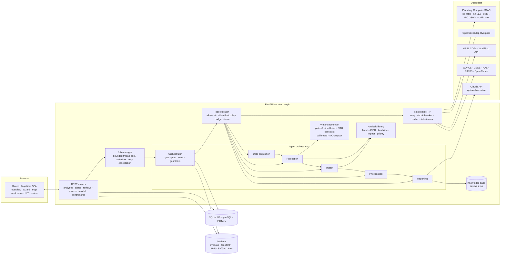
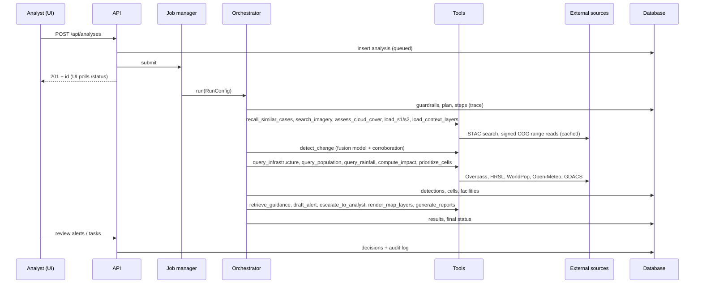

# Architecture

AegisEO is a two-tier web application (React SPA + FastAPI service) with an in-process,
closed-loop agent that turns Sentinel-1/2 observations into response priorities. It is
deliberately a *single deployable service* plus a database: simple to run, test and reason
about, with clear seams (data-source adapters, tool registry, job runner) where it could be
split later.

## Component view

| Layer | Module | Responsibility |
|---|---|---|
| UI | `frontend/src` | Guided analysis wizard, map workspace (layers, swipe compare, popups), priorities with explanations, evidence/trace viewer, review queue, alerts, data-source health, model card and benchmarks. |
| API | `aegis/api`, `aegis/main.py` | Validation (pydantic), auth (bearer tokens, roles), rate limiting, request IDs, uniform error envelopes, Prometheus metrics, security headers, safe file serving. |
| Jobs | `aegis/jobs.py` | Runs analyses on a bounded pool; the DB row is the source of truth; queued runs are resubmitted and running runs marked `interrupted` after a restart. |
| Agent | `aegis/agents/*` | Orchestrator, specialists, explicit state, tools, guardrails, memory/RAG, narrative, recorder. |
| Perception | `aegis/ml/*` | Model definitions, training, evaluation, calibrated inference with uncertainty, classical baselines. |
| Analysis | `aegis/analysis/*` | Hazard detectors, exposure, prioritisation, indices, SAR and terrain helpers. |
| Data | `aegis/sources/*`, `aegis/net/http.py` | STAC search and signing, COG reading onto a common UTM grid with a raster cache, OSM, population, hazard feeds, source registry and health. |
| Storage | `aegis/db.py` | SQLAlchemy 2.0 models; SQLite default (WAL), PostgreSQL in Docker with PostGIS generated geometry columns + GiST indexes. |
| Reports | `aegis/reports/*` | Web-Mercator overlays, GeoTIFF exports, PDF/CSV/GeoJSON from persisted records. |

## Agent state-action loop

```mermaid
stateDiagram-v2
  [*] --> Observe: request (AOI, hazard, dates)
  Observe --> Rejected: G01-G03 block
  Observe --> Memory: inputs valid
  Memory --> Plan: similar cases + analyst corrections
  Plan --> Acquire: explicit plan (10 steps)
  Acquire --> Acquire: P3 extend window / P4 match orbit / P2 pick clearest optical
  Acquire --> InsufficientData: G04 block
  Acquire --> Perceive: bundle + G05-G09 checks
  Perceive --> Perceive: P5 SAR-led re-run (cloudy optical + low agreement)
  Perceive --> SemanticState: hazard result
  SemanticState --> Guardrails: facts with units and evidence ids
  Guardrails --> Act: G10-G15 (warn / escalate)
  Act --> Act: P8/P9 degrade gracefully when a source fails
  Act --> Report: exposure + priorities
  Report --> HITL: G16 grounding, G17 language; drafts + review tasks
  HITL --> Outcome
  Outcome --> Feedback: metrics, trace
  Feedback --> [*]
  note right of HITL
    Humans approve/reject alerts (G18 + external tool),
    resolve review tasks, override priorities.
    Decisions feed episodic memory.
  end note
```

## One analysis, end to end

## Key decisions

| Decision | Choice | Why |
|---|---|---|
| Imagery access | Planetary Computer STAC + signed COG range reads | Free, no account, both Sentinel-1 RTC and Sentinel-2 L2A plus DEM/JRC/WorldCover in one catalogue; only AOI windows are downloaded. |
| Common grid | UTM of the AOI centroid, 20 m default, auto-coarsened above 2.6 Mpx | Bounded memory/runtime; metric pixels for areas and distances. |
| Perception | Gated-fusion U-Net trained on Sen1Floods11, plus S1 specialist where optical is missing | Best measured robustness across sensor conditions (selected on validation data). |
| Agent orchestration | Deterministic planner with documented rules and a typed tool registry | Testable, reproducible, auditable; an LLM is used only for optional prose under a grounding check. |
| Storage | SQLAlchemy with GeoJSON + bbox columns; PostGIS columns when available | One code path that runs on SQLite (zero setup) and PostgreSQL/PostGIS (deployment). |
| Background work | In-process thread pool | Sufficient for a single-node deployment; avoids a broker. A queue (e.g. Redis/RQ) would be the step to multiple API replicas. |
| Basemaps | OpenFreeMap vector + EOX Sentinel-2 cloudless | Free and key-less; falls back to a plain background offline. |

## Reliability mechanisms

* **External failures**: every request has timeouts, bounded retries with jittered back-off, a per-source circuit breaker and a file cache that serves the last good response (flagged `stale`) when a source is down. Offline mode runs entirely from caches.
* **Partial failures**: each tool failure is caught by the calling agent, recorded, and handled by a planning rule (continue without the source, mark the factor missing, reduce confidence). One failed overlay or report never fails the analysis.
* **Honest outcomes**: runs end as `completed`, `completed_with_warnings`, `needs_review`, `insufficient_data`, `rejected`, `failed`, `cancelled` or `interrupted` - never a silent success.
* **Determinism**: MC-dropout masks come from per-tile seeded generators, so the same inputs give the same outputs on the same hardware (CPU and GPU arithmetic can differ in the last digits, e.g. 4.65 vs 4.66 km2 on the synthetic flood).
* **Observability**: JSON logs with request/analysis IDs; `/metrics` exposes request, tool, guardrail, job and external-call counters and latencies; `/api/health/ready` checks the DB and model.

## Scaling notes

The API runs one process with `AEGIS_WORKER_THREADS` concurrent analyses (NumPy, GDAL and
PyTorch release the GIL). To scale out: move job execution to workers behind a queue, keep the
API stateless, and point all replicas at the same PostgreSQL and shared artefact storage.
